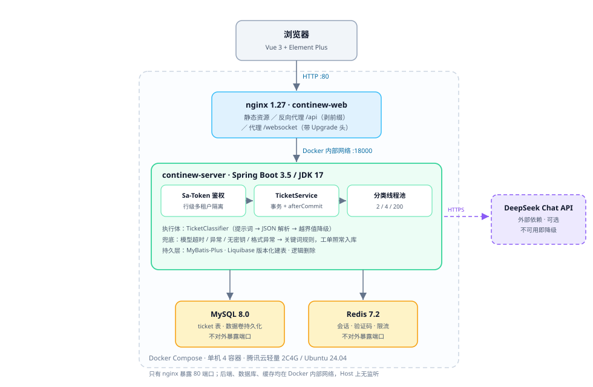
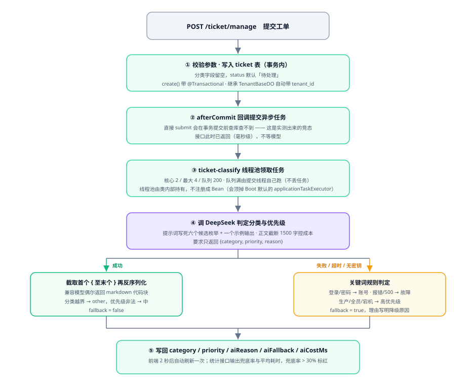

# AI 工单管理系统

在开源后台框架 [ContiNew Admin](https://github.com/continew-org/continew-admin) 之上，自研了一个**由大模型做分类决策的工单模块**，并完成了从编译到公网部署的全链路落地。

用户提交工单后，模型判断它属于哪个分类、有多紧急，判断理由和耗时一并落库；模型不可用时自动降级为关键词规则，工单照常入库，页面用「兜底率」把这种降级暴露出来。

线上地址：**http://134.175.137.18** 　账号密码不在公开仓库写明，避免被扫描器批量尝试；需要体验可来信索要，或按下方 [本地运行](#本地运行) 自行起一套。



---

## 一句话说清做了什么

| 维度 | 内容 |
| --- | --- |
| 业务闭环 | 提交工单 → 模型判定分类与紧急程度 → 分流 → 人工处理 → 统计兜底率与耗时 |
| 我写的部分 | AI 工单插件（分类器、异步任务、Controller、实体、建表脚本）、前端工单页面、生产部署编排 |
| 借用底座 | ContiNew Admin v4.2.0（Spring Boot 3.5 + Vue 3 的通用后台框架），用户/角色/菜单/租户等基础能力 |
| 代码规模 | 新增后端 16 个类、1 个 Liquibase changeset、前端 2 个目录 |
| 线上状态 | 4 个容器全部运行，广州 · 2 核 4G · Ubuntu 24.04 |

---

## 核心链路



关键点是**提交接口不等模型**。落库并提交事务之后，用 `afterCommit` 回调把分类任务丢进线程池，接口毫秒级返回；模型跑完再把 `category` / `priority` / `aiReason` / `aiCostMs` 写回同一行记录。

如果做成同步，模型高峰期慢到 3 秒，提交按钮就得转 3 秒的圈。异步的代价是提交瞬间分类字段是空的，前端多刷一次列表 —— 对工单系统来说这个代价可以接受，用户关心的是「我提交成功了」，不是「分类立刻出现」。

---

## 三个值得说的设计取舍

### 1. 规则没有删掉，而是降级成兜底

大模型是外部依赖，会超时、会限流、会欠费。分类失败不能让工单提交失败，所以每一条失败路径都有出口：

| 异常场景 | 处理方式 |
| --- | --- |
| 没配 API Key | 直接走规则，不发起网络请求 |
| 调用抛异常 / 超时（连接 5s、读取 20s） | 捕获后走规则，理由里写明异常类型 |
| 返回内容带 markdown 代码块 | 截取首个 `{` 到末个 `}` 再解析，仍失败则走规则 |
| 返回的分类值不在枚举里 | `parse()` 降级为 `other`，不抛异常 |
| 返回的优先级非法 | 降级为「中」，宁可让人多看一眼也不让工单沉底 |

兜底不是隐藏的：每条工单有 `aiFallback` 标记，统计接口输出兜底率，**超过 30% 页面标红**，用来发现「模型悄悄挂了而没人知道」。

### 2. 事务与异步的竞态

第一版是 `super.create(req)` 之后直接 `submit(id)`，实测出现过 `工单不存在，跳过分类` 的日志 —— 异步线程在事务提交前就去查库，查不到。

修复方式是 `TransactionSynchronizationManager.registerSynchronization` 注册 `afterCommit` 回调。这种 bug 的表现是**偶发**的分类丢失，不修的话线上极难定位。

### 3. 线程池不注册成 Bean

把 `ThreadPoolTaskExecutor` 注册成 Spring Bean 会触发一个连锁反应：容器里已经有 `Executor` 类型的 Bean，Spring Boot 的 `TaskExecutionAutoConfiguration` 就不再创建默认的 `applicationTaskExecutor`，而框架里已有代码依赖它，应用直接启动失败。

同时 `@Async` 在这里也不可用 —— 同类自调用会绕过 AOP 代理，实际还是同步执行。

最终方案是类内部自持一个线程池实例（核心 2 / 最大 4 / 队列 200），拒绝策略用 `CallerRunsPolicy`：队列满了由提交线程自己跑，宁可慢一点也不丢任务。

---

## 实测数据

用 4 条**刻意避开关键词**的工单做对照，验证模型确实在起作用（2026-11-02，DeepSeek-V4.1-Flash）：

| 工单标题 | 关键词规则会判成 | 模型实际判定 | 耗时 |
| --- | --- | --- | --- |
| 登不进去 | 其他 / 中（**没有「登录」二字，规则命不中**） | **账号与权限 / 高** | 2162 ms |
| 点导出之后一直转圈 | 数据问题 / 中 | 数据问题 / 中 | 1938 ms |
| 这个表格能不能按部门分一下 | 功能需求 / 中 | **功能需求 / 低** | 1341 ms |
| 上周的数据好像少了几条 | 数据问题 / 中 | 数据问题 / 中 | 950 ms |

第一条最能说明问题：规则只能匹配「登录」这个字面词，模型能从「停在加载页」「整个组都用不了」读出影响范围，并把优先级提到「高」。

平均耗时约 1.6 秒，单条成本在 0.001 元量级（一次请求约 500 输入 token + 80 输出 token）。`aiReason` 是可解释性的落点，例如：

> 整个组多人卡在登录加载页无法进入，属登录失败且影响范围大

---

## 技术栈

| 层次 | 选型 |
| --- | --- |
| 后端 | Java 17 · Spring Boot 3.5.16 · MyBatis-Plus · Sa-Token · Liquibase |
| AI | Spring AI 1.1.8（OpenAI 协议兼容）· DeepSeek `deepseek-flash` · temperature 0.1 |
| 数据 | MySQL 8.0.42 · Redis 7.2.8 |
| 前端 | Vue 3 · TypeScript · Element Plus · Vite |
| 部署 | Docker Compose · nginx 1.27 · 腾讯云轻量应用服务器 |

模型接入用的是 OpenAI 兼容协议，换 `base-url` 和 `model` 就能切到别家，业务代码不用动。温度调 0.1 是因为分类任务要的是稳定复现，不需要发散。

---

## 目录结构

```
ai-ticket-admin/
├── backend/                        # 后端（ContiNew Admin 11 个模块 + 自研插件）
│   └── continew-plugin/
│       └── continew-plugin-ticket/ # ★ AI 工单插件
│           └── src/main/java/top/continew/admin/ticket/
│               ├── ai/             #   TicketClassifier：提示词、解析、规则兜底
│               ├── controller/     #   TicketController：标准 CRUD + 重新分类 + 统计
│               ├── service/impl/   #   TicketServiceImpl、TicketClassifyTask（线程池）
│               ├── model/          #   实体、请求、响应、查询条件
│               └── enums/          #   分类、优先级、状态
├── frontend/                       # 前端（Vue 3）
│   └── src/views/ticket/           # ★ 工单管理页面
├── deploy/                         # ★ 生产部署
│   ├── docker-compose.yml          #   4 容器编排
│   ├── nginx.conf                  #   IP 直连版配置
│   ├── setup.sh                    #   服务器初始化与密钥生成
│   └── 部署说明.md                  #   运维命令、三个必须知道的坑、密钥清单
└── docs/
    ├── images/                     # 架构图
    └── api/                        # 接口文档（Markdown / 离线 HTML / OpenAPI）
```

---

## 本地运行

**前置**：JDK 17、Node.js 20+、pnpm、MySQL 8、Redis 7。

```bash
# 1. 建库（Liquibase 只建表不建库，库必须手工建）
mysql -u root -p -e "CREATE DATABASE continew_admin DEFAULT CHARSET utf8mb4;"

# 2. 后端
cd backend
./mvnw clean package -DskipTests
cd continew-server/target/app
DB_PWD=<你的MySQL密码> java -jar bin/continew-admin.jar --server.port=8000

# 3. 前端
cd frontend
pnpm install
pnpm dev        # http://localhost:5173
```

访问 `http://localhost:5173`，登录后在左侧菜单「AI 工单 → 工单管理」提交几条工单即可。

不配 `DEEPSEEK_API_KEY` 也能跑，只是所有工单都会走规则兜底（页面上兜底率 100%），这本身就是降级逻辑的现场演示。

---

## 部署

生产环境用 Docker Compose 编排 4 个容器：`nginx` + `Spring Boot` + `MySQL` + `Redis`。只有 nginx 对外暴露 80 端口，其余在内部网络。

```bash
cd deploy
cat 部署说明.md      # 密钥清单、运维命令、三个必须知道的坑
```

部署时踩到并记录下来的三个坑，都是文档里查不到的：

1. **前端 RSA 公钥是硬编码的**，和后端私钥必须配对。项目自带的 512 位演示公钥要换掉，只换后端会导致「密码解密失败」。
2. **`justauth.enabled` 开关是死的**，关掉会因缺少 `AuthRequestFactory` Bean 启动失败，即使不用第三方登录也必须置 `true`。
3. **没有 HTTPS 时 Cookie 必须降级**，`cookie-secure=true` 和 `__Host-` 前缀都要求 HTTPS，纯 HTTP 部署会导致刷新页面就掉线。

---

## 接口文档

| 文件 | 说明 |
| --- | --- |
| [`docs/api/api-reference.html`](./docs/api/api-reference.html) | 离线可交互手册，双击打开即可用，含参数表与可复制的 curl |
| [`docs/api/ticket-api.md`](./docs/api/ticket-api.md) | 9 个接口的完整文字说明 |
| [`docs/api/openapi.json`](./docs/api/openapi.json) | OpenAPI 3.1 规范，服务端真实导出，可导入 Postman / Apifox |

接口一览：

| 方法 | 路径 | 说明 |
| --- | --- | --- |
| POST | `/ticket/manage` | 创建工单（异步触发分类） |
| GET | `/ticket/manage` | 分页查询（可按兜底标记筛选） |
| GET | `/ticket/manage/{id}` | 查询详情 |
| PUT | `/ticket/manage/{id}` | 修改（支持人工纠正分类） |
| DELETE | `/ticket/manage/{id}` | 删除单条 |
| DELETE | `/ticket/manage` | 批量删除 |
| POST | `/ticket/manage/{id}/classify` | 重新分类（同步） |
| GET | `/ticket/manage/statistics` | 兜底率、平均耗时等指标 |
| GET | `/ticket/manage/export` | 导出 Excel |

---

## 已知限制

写在这里，是因为它们比「已完成」更能说明下一步该做什么：

- **只有兜底率，没有准确率**。兜底率只能说明模型活着，不能说明它判得对。要测准确率得人工标注一批样本做基准。
- **没有做结果缓存**。相似工单每次都重新调模型，标题向量相似度命中历史结果可以省掉一半 token。
- **只打标签，没有自动派单**。分类结果目前靠人工看，没有按分类自动分配处理人。
- **第三方登录、定时任务、对象存储未启用**。分别是没配 client-id、没部署调度中心、用本地磁盘代替对象存储。
- **纯 HTTP 部署**。没有域名和证书，因此做了一处 Cookie 降级；补齐 HTTPS 后应当恢复标准配置。

---

## 关于开源底座

后台框架来自 [ContiNew Admin](https://github.com/continew-org/continew-admin) 与 [continew-admin-ui](https://github.com/continew-org/continew-admin-ui)，Apache-2.0 授权，版权归原作者 Charles7c 及贡献者所有。本项目对其有少量修改（版本号、AI 相关配置、RSA 公钥、打包参数），修改范围见 [NOTICE](./NOTICE)。

在 `v4.2.0` 基础上新增的功能代码集中在 `backend/continew-plugin/continew-plugin-ticket/`、`frontend/src/views/ticket/`、`frontend/src/apis/ticket/`、`deploy/`、`docs/` 五个位置。

许可证：[Apache License 2.0](./LICENSE)
